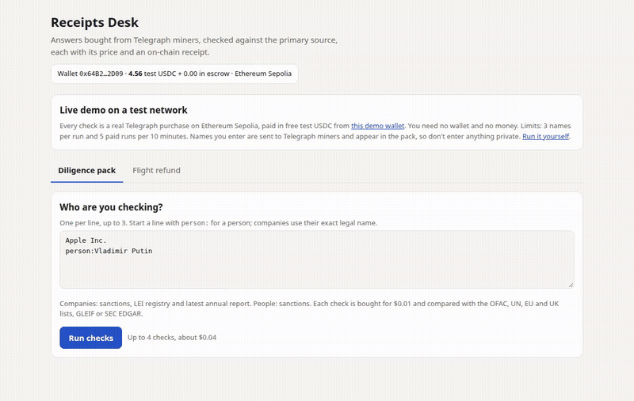

# Receipts Desk



[](https://github.com/jayhemnani9910/telegraph-receipts-desk/actions/workflows/test.yml) [](LICENSE)

Sanctions checks for paralegals and refund claims for flyers, checked against official sources.

```bash
git clone https://github.com/jayhemnani9910/telegraph-receipts-desk.git && cd telegraph-receipts-desk && npm install && cp .env.example .env
```

**Try it with no wallet:** <https://receipts-desk.vercel.app>. The clip above is that page running its free eligibility check. Buying an answer costs test USDC, so the clip stops before that step.

**Demo video (2 min), a real paid run:** <https://x.com/jeyhemnani9/status/2118799203417854385>

I made this for Telegraph Hackathon Season II. [Telegraph](https://anjoman.ai/docs) is a network where apps pay per question to independent data providers called miners. A paid answer can still be wrong, so these two apps treat each one as a claim and check it.

- **Diligence pack:** sanctions, company registry and SEC filing checks, each compared with the official OFAC, UN, EU and UK lists, GLEIF or SEC EDGAR, with an invoice of receipts.
- **Flight refund claim:** checks a trip against the US DOT refund rule, buys airport disruption checks, compares them with the FAA feed, and drafts the refund email. Nothing is sent automatically.

This runs on the **Ethereum Sepolia testnet** (chain 11155111, Telegraph V2). All payments use free test USDC, so nothing here spends real money. There are no customers or outside users yet.

## Usage

These work straight after the install line, with no wallet:

```bash
npm test                  # 69 tests, no wallet or network
npm run rankings          # supply, operators and top miners per Intent
npm run probe -- --dry    # fetches the official values only
```

`npm run rankings` on Nov 5, 2026:

```
SANCTIONS_SCREENING_MATCH    miners  17  operators  7  #1 txlens(9002) 1.00  #2 san-os-au(78007) 1.00  #3 san-os-ofac(78004) 1.00
CORPORATE_REGISTRY_LOOKUP    miners  22  operators  6  #1 datawire-corporate-registry-lookup(7393) 1.00  #2 corp-os-ofac(98005) 1.00  #3 livecert(4433) 1.00
TRAVEL_DISRUPTION            miners  14  operators  3  #1 travelwire-travel-disruption(7602) 0.99  #2 zk-travel-nas(710639) 0.99  #3 chainsight-oracle(302) 0.98
```

To buy answers, see [Run it yourself](#run-it-yourself).

## How it works

1. **Get the official answer.** It's free. FAA status, sanctions lists, GLEIF and SEC EDGAR are read directly.
2. **Buy the same answer through Telegraph.** Each call names the Intent and its typed params, so a bad request is refused before any payment. The node's price is $0.01 per call, paid over x402.
3. **Compare.** Each answer is marked `confirmed`, `contradicted`, `unconfirmed` or `network failed`. An answer we can't compare is `unconfirmed`, not a guess. Findings in a pack or claim always come from the official source, with its URL and timestamp.
4. **Keep the receipt.** Every paid call goes in `data/ledger.jsonl` with its receipt hash and transaction. Each pack or claim links its payment on Etherscan and the node's own record of the answer (`GET /engine/v1/signal/<hash>`), which shows the paying wallet, the miner and the transaction.

Both apps ask a few known-good miners by ID first, then fall back to routing. A miner that can't take the request is refused before payment, so that costs nothing.

## Run it yourself

Requires Node 20.12+. After the install line:

```bash
npm run wallet:new     # creates a test wallet in .env and prints its address
```

Fund it, both free:
1. Send the address a little Sepolia ETH from <https://sepolia-faucet.pk910.de>. Minting needs it for gas.
2. Mint test USDC, then buy your first answer:

```bash
npm run mint                 # 10 test USDC (amount: npm run mint -- 20)
npm run first-check -- JFK   # $0.01
```

Then try the apps:

```bash
npm run diligence -- "Apple Inc." "person:Vladimir Putin"       # up to $0.04
npm run flight-claim -- apps/flight-claim/example-trip.json     # about $0.02
npm run web                                                     # both in the browser at http://localhost:3402
```

New to Telegraph? The [tutorial](docs/tutorial.md) goes through each step with sample output. Problems? See [Troubleshooting](docs/tutorial.md#troubleshooting).

## Known limitations

- **Answer quality varies.** A wrong answer is reported as `contradicted`. A miner that answers 200 with a useless answer still counts as delivered and is billed.
- **Registry answers rest on a small trial.** I ask TxLens first because it got 14 of 14 calls right across six US, UK and German companies on Nov 4, 2026, against 9 of 12 for DataWire, which is now the backup. That's a small sample and can change.
- **SEC filings have one named miner.** Filing Window (77131) is asked first, and routing is the only fallback.
- **Named miners can change.** IDs are hard-coded in `apps/legal/pack.ts` and `apps/flight-claim/trip.ts`.
- **Airport-level only.** The flight app checks airport disruption from the FAA, not your specific flight, and US airports only. You enter your flight's new times yourself. The refund right does not depend on the airport check.
- **Name matching is simple.** Every word must appear in a listed name; long words may be one letter off, shown for review only. Other spellings and transliterations can be missed. A name match alone gives REVIEW, not HIT. Owners are followed only as far as the parents a company reports to GLEIF, and many report none.
- **List dates differ.** Sanctions lists are downloaded once a day and each pack shows the date on each list. When I fetched them on Nov 5, 2026, the EU file was dated Oct 23. A list that cannot be read is reported as not checked and the verdict becomes REVIEW; the EU download returned HTTP 500 on Nov 7–8, 2026.
- **Renumbered flights.** The US DOT is [not enforcing](https://www.federalregister.gov/documents/2026/07/07/2026-13675/airline-refunds-and-other-consumer-protections) the refund rule until July 7, 2027 when a flight only gets a new number and has no significant change or delay. Don't tick "cancelled" for that case; the app can't tell.
- **Not legal advice.** Packs and claims are drafts for a person to review.

## Commands

| Command | Cost | What it does |
|---|---|---|
| `npm run first-check -- JFK` | $0.01 | Buys one answer and checks it against the FAA; the [tutorial](docs/tutorial.md) walks through it |
| `npm test` | free | Runs the tests, with no wallet or network |
| `npm run balance` | free | ETH, test USDC and escrow balance of the wallet |
| `npm run rankings` | free | Supply, operators and top-ranked miners for every Intent the probe covers |
| `npm run probe -- --dry` | free | Fetches the independent truth values only |
| `npm run probe` | ~$0.21 testnet USDC | Asks every known-answer question through Telegraph, grades it, saves receipts |
| `npm run probe -- --mission=legal` | ~$0.08 testnet USDC | Same, one mission only |
| `npm run probe -- --regrade=data/probe/<file>.json` | free | Grades a saved run again |
| `npm run reconcile -- --hours=1` | free | Matches every on-chain USDC transfer from the wallet to a ledger entry; flags transfers with no receipt and failed calls whose payment stays in escrow |
| `npm run reconcile -- --wallet=0x... --hours=24` | free | Lists any wallet's payments to Telegraph with time and tx link, plus its escrow balance; no key needed |

Outputs:
- `data/ledger.jsonl`: one line per paid call, keyed by `receipt_hash`; `tx_hash` falls back to the x402 settlement when Telegraph sends no receipt
- `data/probe/<time>.json`: full answers, receipts and Etherscan links

## Legal: diligence pack

```bash
npm run diligence -- "Apple Inc." "Tesla, Inc." "person:Vladimir Putin, dob:1952-10-07"
```

Each entity gets one verdict:
- **HIT:** listed under this exact name, or with the same birth date.
- **REVIEW:** a name match that a name alone can't settle, a similar name one letter off, a parent company that is listed, or a list that couldn't be read.
- **CLEAR:** none of those. Same-name entries whose listed birth dates all differ from the one given are ruled out and counted.

The birth date (`dob:YYYY-MM-DD` or `dob:YYYY`) is used only against the official lists and is never sent to the network. For companies, the parents reported to GLEIF are screened against the same lists for free: `SBERBANK CIB (UK) LIMITED` is not listed itself, but its parent Sberbank of Russia is, so it comes back REVIEW.

For each entity the agent buys, through Telegraph:
- sanctions screening (`SANCTIONS_SCREENING_MATCH_GENERAL`)
- for companies, an LEI registry lookup (`CORPORATE_REGISTRY_LOOKUP_GENERAL`) and, for SEC registrants, the latest annual report (`REGULATORY_FILING_MONITOR_GENERAL`)

Output in `data/packs/<time>/`:
- `pack.md`: findings per entity, the limits of each check, an invoice with every receipt and Etherscan link, and a list of network answers that were wrong, and failed calls that took a payment
- `pack.json`: the same, with the full network answers

Costs $0.01 testnet USDC per check, up to 3 checks per company.

## Consumer Automation: flight refund claim

```bash
mkdir -p data && cp apps/flight-claim/example-trip.json data/my-trip.json   # data/ is gitignored; edit your flight details
npm run flight-claim -- data/my-trip.json
```

1. Checks the trip against the US DOT refund rule (14 CFR Part 260): cancelled, or moved 3+ hours (6+ international), and you did not fly. If not eligible it stops and buys nothing.
2. For the departure and arrival airports it buys a disruption report through Telegraph (`TRAVEL_DISRUPTION_GENERAL`, param `route_or_flight`) and checks it against the FAA National Airspace System status feed.
3. Writes to `data/claims/<time>/`:
   - `claim.eml`: the refund request to the airline, citing FAA-confirmed disruptions with their Telegraph receipts. Open it in your mail app, review, send.
   - `claim.md`: eligibility, every airport check, cost, receipt and Etherscan link
   - `claim.json`: everything, including the full network answers

Nothing is sent automatically. Only airport codes go to the network; your name and booking stay local. About $0.02 testnet USDC per claim.

### Watch a trip until it qualifies

```bash
npm run flight-watch -- data/my-trip.json --every=5   # minutes between checks
```

Every round is free: it re-reads the trip file and the FAA feed and prints one status line. When the airline changes your flight, update `revisedDeparture`, `revisedArrival` or `cancelled` in the file. The moment the change crosses the threshold it buys the evidence, drafts the claim as above, and stops. If `traveled` becomes true it stops without buying.

## Web page

```bash
npm run web   # then open http://localhost:3402
```

Both apps in the browser: the diligence pack, and the flight refund (eligibility check free, then buy and draft). Shows each finding, the network's answer, cost, receipt and Etherscan link, with downloads for the pack, `claim.eml` and the evidence. It pays from the wallet in `.env`, so it listens on 127.0.0.1 only, accepts JSON only and refuses other host names.

## Public ledger

The page's **Public ledger** tab (<https://receipts-desk.vercel.app/#ledger>) lists every payment the wallet made to Telegraph, read from the [Blockscout](https://eth-sepolia.blockscout.com) API rather than our own logs, grouped into runs. Runs at the maintainer's test times are labelled. `GET /api/ledger` returns the same as JSON.

## MCP for agents

The hosted demo is also an MCP server, so an agent can run the checks itself:

```bash
claude mcp add --transport http receipts-desk https://receipts-desk.vercel.app/api/mcp
```

Tools: `diligence_pack` (paid from the demo wallet, same limits as the page), `flight_refund_eligibility` (free, no personal details) and `public_ledger` (free). Locally, `npm run web` serves the same at `http://localhost:3402/api/mcp`, paying from your own wallet.

## Hosted demo

<https://receipts-desk.vercel.app> runs the same page (`web/hosted.ts`) so someone can try it with no wallet. It pays from a [separate demo wallet](https://sepolia.etherscan.io/address/0x64B27BdfF2119ba557b9F19c5B1229FDCA312D09) holding test USDC, which is the hard limit on what it can spend. It also allows 3 names per run and 5 paid runs per 10 minutes per visitor, and deletes each draft after the response.

To deploy your own:

```bash
npm run build:hosted   # writes only the build to dist/hosted
cd dist/hosted
vercel link --yes --project receipts-desk
vercel env add PRIVATE_KEY production --sensitive   # a separate test wallet, never your main one
printf '/tmp/receipts' | vercel env add DATA_DIR production
printf '150000' | vercel env add MAX_PER_RUN_UUSDC production
vercel deploy --prebuilt --prod
```

## Failed calls and escrow

On V2 an x402 payment settles on-chain before the miner is called, and lands in your escrow balance on the Diamond. Delivered calls are charged against it at the next epoch close, so what stays is the amount of the calls that failed. Those show on-chain with no receipt, and are not lost: spend them with the escrow payment scheme, or withdraw them. `npm run balance` and `npm run reconcile` show the balance; right after a run it also includes that run's delivered calls until the epoch closes.

## Tests

```bash
npm test
```

No wallet or network needed: the tests use a throwaway wallet and fail any network call, so they can't spend anything. They cover the refund rule's limits, how answers are compared with official sources (including wrong answers we actually received), the sanctions list parsers, the retry and spend rules, and how bad input is refused. They don't test the miners or the live sources; `npm run probe` and the apps do that.

## Spend controls

Set in `.env`, in micro-USDC (`10000` = $0.01):
- `MAX_PER_CALL_UUSDC`: the client refuses to sign any single payment above this.
- `MAX_PER_RUN_UUSDC`: the client stops paying once a run reaches this total.

## Who it's for

See the [commercial summary](docs/commercial-summary.md): buyers, costs, measured results and what remains before production.

## Contributing

See [CONTRIBUTING.md](CONTRIBUTING.md). Tried the quickstart or tutorial? [Open an issue](https://github.com/jayhemnani9910/telegraph-receipts-desk/issues) with what worked and what did not.

Want to build on Telegraph? Its [bounty board](https://github.com/telegraphprotocol/bounties/issues) lists missing providers and evaluation work, and the SEC filings gap above is one place a better miner would help.

## Mainnet

Chain ID, token address, node URL and explorer are configuration only (`.env`), not code.

## License

[MIT](LICENSE)
